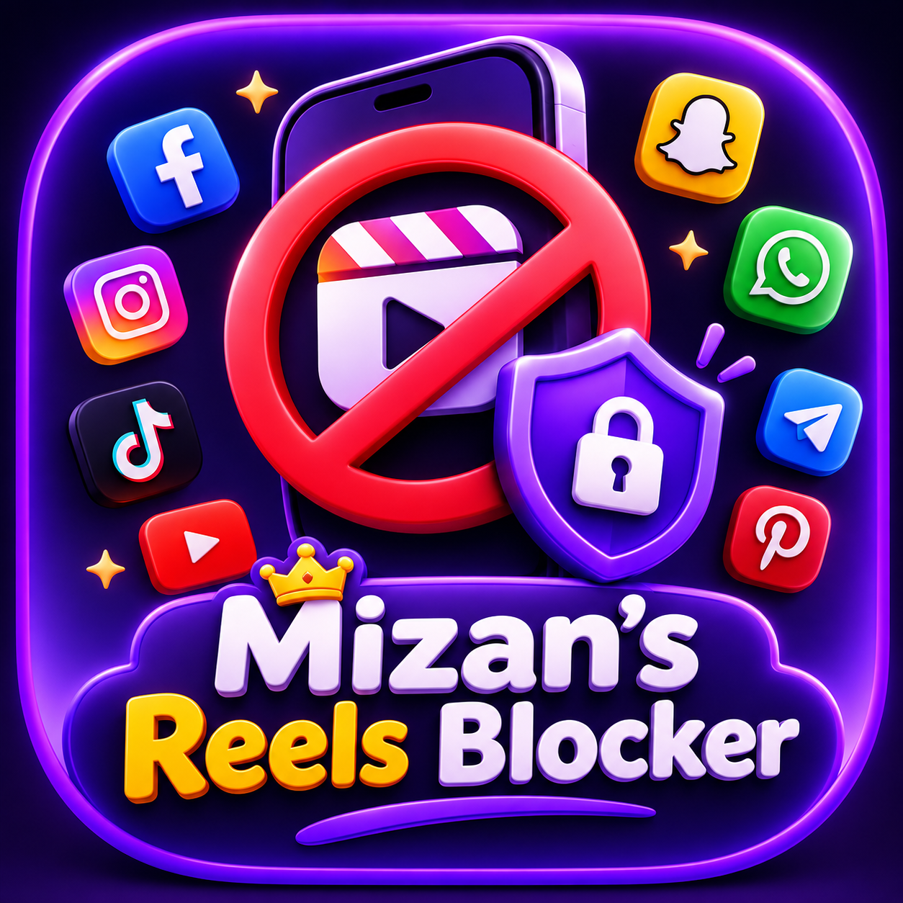

# Mizan's Reels Blocker
**Block Reels. Save Time. Stay Focused.** — 100% ad-free.

Blocks Reels/Shorts inside Facebook, Instagram, YouTube, TikTok & Snapchat using an Accessibility Service, without blocking the whole app (except TikTok).

## Build
Push to GitHub → **Actions → Build APK** → download the APK artifact.
Or locally: `gradle assembleDebug` (Android Studio / JDK 17).

## Use
Install, open, tap **Enable Accessibility Service**, turn the app on.
Warning screen → **Pause for 5 Minutes** (fixed, can't be extended; auto-resumes).
